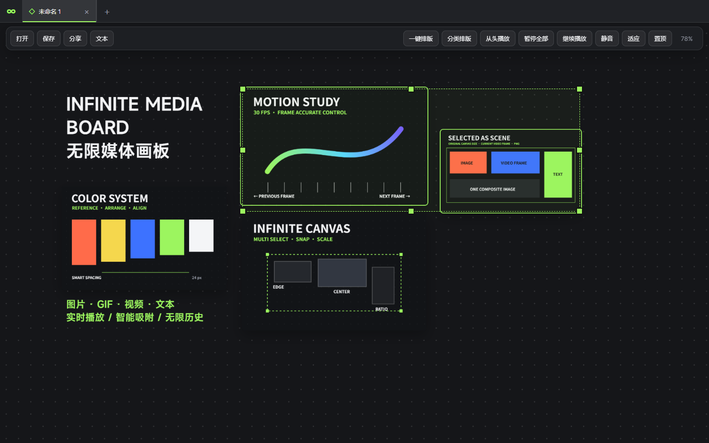
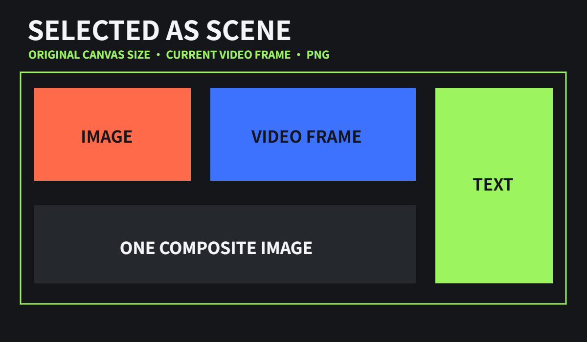

# Infinite Media Board

<p align="center">
  <strong>把图片、GIF、视频和文字放进一张真正自由的无限画布。</strong><br>
  <strong>Place images, GIFs, videos, and text on one truly free infinite canvas.</strong>
</p>

<p align="center">
  <a href="docs/README.zh-CN.md">中文说明</a> ·
  <a href="docs/README.en.md">English</a> ·
  <a href="../../releases/latest">下载最新版 / Download</a>
</p>



Infinite Media Board 是一款面向 Windows 的桌面媒体画板，灵感来自 PureRef 与 Figma 的自由工作方式。它能在同一张无限画布上实时展示图片、GIF、视频和文字，支持多选、智能吸附、紧凑排版、视频逐帧查看以及跨平台 HTML 分享。

Infinite Media Board is a Windows desktop media board inspired by the free-form workflows of PureRef and Figma. It keeps images, GIFs, videos, and text together on an infinite canvas with multi-selection, smart snapping, compact layout, frame-by-frame video review, and cross-platform HTML sharing.

## 主要功能 / Highlights

- 图片、GIF、视频和文字共存；软件不设置素材数量上限（实际性能取决于硬件）
- Infinite canvas for images, GIFs, videos, and text, with no artificial item limit
- GIF 与视频实时播放；视频默认静音，鼠标悬停时可单独听声
- Real-time GIF/video playback with default mute and hover audio
- Figma 风格边缘、中心与等间距吸附，绿色参考线实时反馈
- Figma-style edge, center, and equal-spacing snapping with green guides
- 框选和多选后整体移动、八方向缩放、复制、层级调整与局部排版
- Box/multi-select, group move, eight-handle resize, duplicate, layer ordering, and partial layout
- `.imb` 文件嵌入全部素材；删除原始文件后，已保存画板仍可完整打开
- Self-contained `.imb` boards embed their media and survive deletion of the source files
- 导出可编辑或只读 HTML，在手机、macOS、Windows 浏览器中查看
- Export editable or read-only HTML for viewing on phones, macOS, and Windows
- 多选素材按原尺寸合并导出 PNG；视频与 GIF 使用当前帧
- Export selected items as one original-resolution PNG using the current video/GIF frame



## 快速开始 / Quick start

下载 GitHub Releases 中的便携版 ZIP，解压后运行 `Infinite Media Board.exe`。首次运行不需要安装。

Download the portable ZIP from GitHub Releases, extract it, and run `Infinite Media Board.exe`. No installation is required.

开发版 / Development:

```powershell
npm install
npm start
```

构建 Windows 安装包 / Build the Windows installer:

```powershell
npm run dist
```

## 文档 / Documentation

- [完整中文说明](docs/README.zh-CN.md)
- [Full English guide](docs/README.en.md)
- [发布与版本策略](RELEASE_POLICY.md)

## 许可 / License

本项目目前未采用开源许可证，保留所有权利。详见 [LICENSE](LICENSE)。

This project is currently not distributed under an open-source license. All rights are reserved. See [LICENSE](LICENSE).

> 文档中的界面示意图使用为本项目全新制作的抽象演示素材，不包含用户此前提供的图片。
>
> All screenshots use newly created abstract demo assets and do not contain previously supplied user images.
