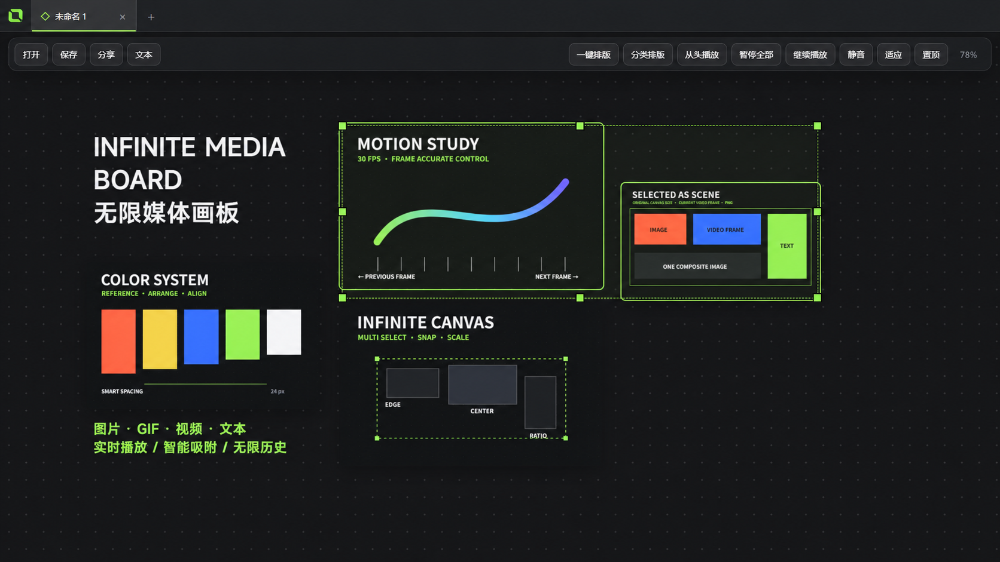
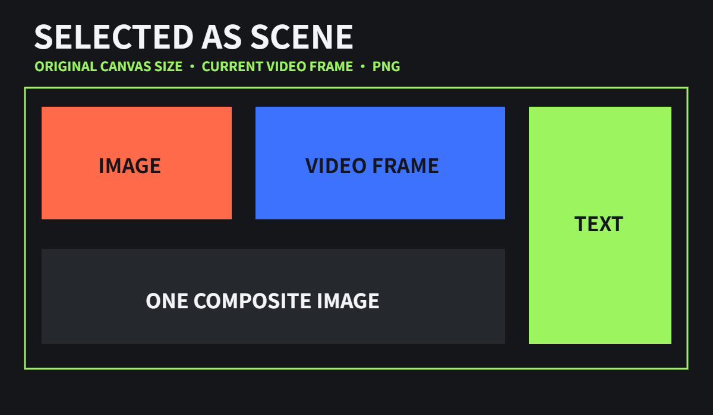

# IMB — Infinite Media Board English Guide

[Home](../README.md) · [中文](README.zh-CN.md) · [Open Web App](https://cramasterzy.github.io/IMB/web/) · [Download latest](../../../releases/latest)



IMB (Infinite Media Board) offers PureRef-style freedom with a canvas built specifically for video, GIF, audio, and motion review. The desktop edition provides the complete native Windows workflow, while the web edition runs directly in macOS and Windows browsers. Images, GIFs, videos, and text live together in real time, and desktop boards can be saved as a single self-contained `.imb` file with all media embedded.

## How IMB differs from PureRef

PureRef remains a mature and powerful tool for still-image reference management, with GIF support added in 2.0. IMB focuses on motion workflows: multiple real-time videos, hover audio, frame stepping, global pause/resume/restart, and browser access or sharing without installing the desktop app. The comparison uses the [official PureRef feature handbook](https://www.pureref.com/handbook/features/) and [official format support page](https://www.pureref.com/support.php). IMB is not affiliated with PureRef.

## Available editions

- Web: runs in macOS and Windows browsers and can be installed as a standalone PWA.
- Windows installer: standard installation, Start Menu entry, and `.imb` file association.
- Windows portable: extract and run without installation.

## Feature overview

### Infinite canvas and media

- Pan across an infinite canvas and zoom the view from 5% to 800%.
- Wheel zoom snaps to 5% increments; double-click the zoom value to enter any custom percentage.
- Batch import PNG, JPG, JPEG, WebP, BMP, GIF, MP4, WebM, MOV, M4V, OGV, and related formats.
- Create text items with the bundled MiSans Demibold font.
- The app imposes no artificial item limit. Real playback capacity depends on memory, GPU, codecs, and media specifications.

### Video and GIF playback

- Play multiple videos and GIFs simultaneously on the canvas.
- Videos are muted by default. Hover a video to hear only that item.
- Pause everything, resume all items from their current time, or restart all videos from the beginning.
- Double-click an individual video to toggle playback.
- Hover a video and press the Left or Right arrow key to step one frame backward or forward.
- Frame stepping preserves playback state: playing video continues, while paused video stays paused.

### Selection, transforms, and snapping

- Drag on empty canvas space for box selection; Shift/Ctrl-click adds or removes items from a selection.
- Move or resize one item or a complete multi-selection using eight handles.
- Hold Shift for proportional scaling, Alt for centered scaling, or Shift+Ctrl for centered proportional scaling.
- Alt-drag an item or a multi-selection to duplicate and move the copy.
- Snap automatically to item edges, centers, and equal spacing, with interface-green guides.
- The snapping threshold is screen-pixel based, so it feels consistent at every canvas zoom level.

### Layout and export

- Compact layout fills gaps to avoid excessive whitespace.
- Category layout separates images, GIFs, and videos.
- With two or more items selected, layout commands affect only the selection. Text is excluded from automatic layout.
- Export selected items as one original-resolution PNG, preserving transparency and using the current video/GIF frame.
- Save one or multiple media items to a chosen folder from the context menu.



### Saving and autosave

- `.imb` is a self-contained board format that embeds all media when saved.
- A saved board continues to work even after the original source files are deleted.
- Once a board has been saved, autosave stays enabled across future sessions.
- Unsaved boards are removed only when the application fully exits; minimizing to the system tray preserves the current session.
- Double-click or drag an `.imb` file into the app to open it. Opening the same file again while the app is running does not create a duplicate board.

### Cross-platform sharing

- Choose either “Editable” or “Read-only” directly from the Share menu.
- Editable HTML includes board editing and automatically stores changes in the browser's local storage.
- Read-only HTML is a pure viewer and retains the top mute control.
- Shared files open in modern mobile, macOS, and Windows browsers without installing Infinite Media Board.
- Browser security normally prevents a page from silently overwriting its own HTML file. Editable-share autosave therefore lives in that browser rather than modifying the original HTML on disk.

### Desktop workflow

- Single-instance behavior: launching the app again restores the existing window.
- Multi-board tabs live in the title bar and support create, close, switch, and drag reorder.
- The window close button hides the app in the system tray; use the tray context menu to exit completely.
- Always-on-top mode uses green state feedback.
- Undo/redo history has no fixed item-count limit; practical capacity depends on available memory.

## Keyboard shortcuts

| Shortcut | Action |
| --- | --- |
| `Ctrl+I` | Add media |
| `Ctrl+S` / `Ctrl+Shift+S` | Save / Save As |
| `Ctrl+O` | Open a board |
| `Ctrl+C` / `Ctrl+V` | Copy / paste items or external clipboard content |
| `Ctrl+Z` / `Ctrl+Shift+Z` | Undo / redo |
| `Delete` | Delete selected items |
| `Ctrl+[` / `Ctrl+]` | Send backward / bring forward |
| `Ctrl+Shift+[` / `Ctrl+Shift+]` | Send to back / bring to front |
| `Ctrl+Alt+T` | Compact layout |
| `Ctrl+Alt+G` | Category layout |
| `Ctrl+T` / `Ctrl+W` | New / close board tab |
| `Ctrl+Tab` / `Ctrl+Shift+Tab` | Next / previous tab |
| `F` | Fit all content |
| `←` / `→` | Step the hovered video backward / forward one frame |
| `Alt+drag` | Duplicate an item or multi-selection |

## Development and build

Requirements: Windows 10/11 and Node.js 20 or newer.

```powershell
npm install
npm start
```

Build the Windows installer:

```powershell
npm run dist
```

Build artifacts are written to the `release` directory. The project uses Electron 44 and the current application version is v0.19.0.

## Performance note

“No artificial item limit” does not mean unlimited hardware resources. Simultaneous decoding of many 4K/8K videos can use substantial VRAM, memory, and CPU. Lower-resolution proxy media is recommended for very high concurrency.

> Every screenshot on this page uses newly created abstract demo assets made for the documentation. No previously supplied user images are included.
