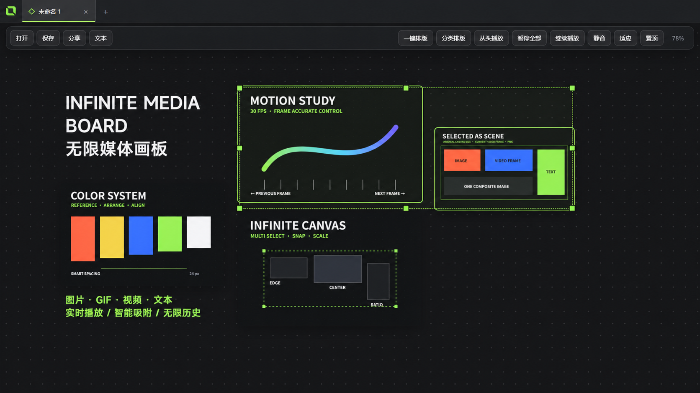
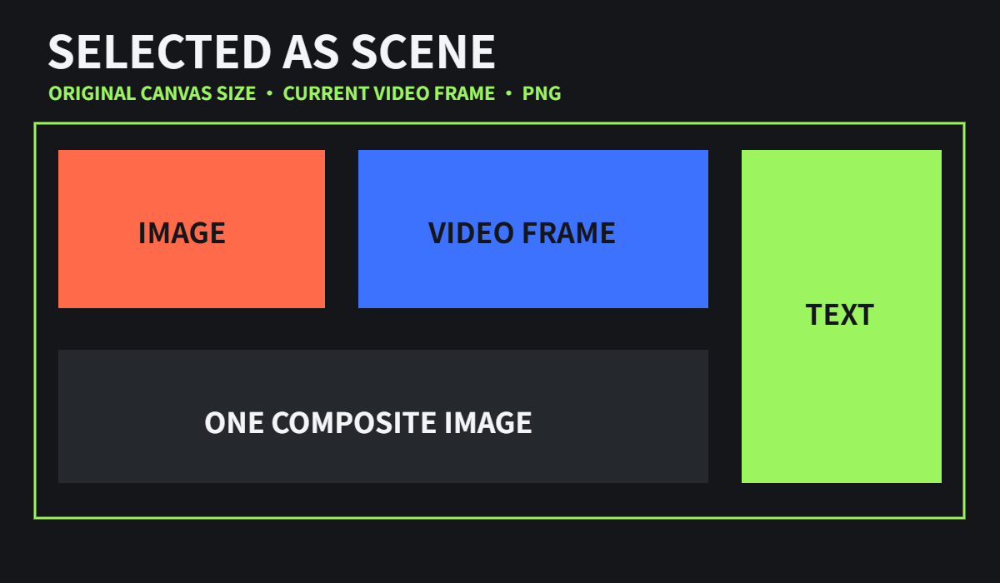

# IMB — Infinite Media Board 中文说明

[返回主页](../README.md) · [English](README.en.md) · [在线使用](https://cramasterzy.github.io/IMB/web/) · [下载最新版](../../../releases/latest)



IMB（Infinite Media Board）是一款像 PureRef 一样自由、但专为视频、GIF、声音与动效审片强化的无限媒体画板。桌面版提供完整的 Windows 原生体验，网页版可直接在 macOS 或 Windows 浏览器中使用。图片、GIF、视频和文字可以自由放置在同一张画布中，桌面画板还能保存成包含全部素材的单一 `.imb` 文件。

## 与 PureRef 的定位差异

PureRef 在静态图片参考管理方面成熟而强大，并从 2.0 开始支持 GIF。IMB 的核心卖点是动态媒体工作流：多个视频同时实时播放、悬停听声、逐帧检查、全部暂停/继续/从头播放，以及无需安装软件的网页使用与分享。对比依据 [PureRef 官方功能手册](https://www.pureref.com/handbook/features/)与[官方格式支持说明](https://www.pureref.com/support.php)。IMB 与 PureRef 官方无关联。

## 可用版本

- 网页版：macOS、Windows 浏览器直接使用，可安装为独立 PWA 窗口。
- Windows 安装版：提供标准安装、开始菜单与 `.imb` 文件关联。
- Windows 便携版：解压即用，不需要安装。

## 功能概览

### 无限画布与媒体

- 无限平移画布，整体画面支持 5%–800% 缩放。
- 鼠标滚轮缩放按 5% 的倍数变化；双击缩放百分比可输入任意自定义值。
- 支持批量拖入 PNG、JPG、JPEG、WebP、BMP、GIF、MP4、WebM、MOV、M4V、OGV 等格式。
- 支持文字素材，内置并使用 MiSans Demibold 字体。
- 软件不设置素材数量上限；实际可同时播放的媒体数量取决于电脑内存、显卡、解码器与素材规格。

### 视频与 GIF

- 多个视频和 GIF 可在画板中同时实时播放。
- 视频默认静音；鼠标悬停在某个视频上时，仅该视频开启声音。
- 可暂停全部、从当前位置继续全部播放，或让全部视频从头播放。
- 双击单个视频可独立播放或暂停。
- 鼠标悬停在视频上时，按左/右方向键后退或前进一帧。
- 逐帧操作会保持原播放状态：播放中的视频继续播放，暂停的视频保持暂停。

### 选择、变换与吸附

- 在空白区域拖动可框选素材；按住 Shift 或 Ctrl 点击可增加或取消多选。
- 单个或多个素材都支持整体移动与八方向缩放。
- 缩放时按住 Shift 等比例缩放，按住 Alt 中心缩放，按住 Shift+Ctrl 中心等比例缩放。
- 按住 Alt 拖动单个素材或多选组，可直接复制并移动副本。
- 自动吸附素材边缘、中心线和相等间距，吸附线使用界面绿色。
- 吸附阈值按屏幕像素计算，因此画布放大或缩小时手感保持一致。

### 排版与导出

- 一键排版使用紧凑填充算法，减少不必要的留白。
- 一键分类排版可按图片、GIF 和视频分区排列。
- 多选两个以上素材后，排版命令只处理选中部分；文字不参与自动排版。
- 右键多选素材可合并导出原尺寸 PNG，透明区域保留，视频和 GIF 使用当前帧。
- 右键单个或多个素材可保存到指定位置。



### 保存与自动保存

- `.imb` 是自包含画板文件，保存时会把画板中的媒体一并嵌入。
- 保存完成后，即使删除原始媒体文件，画板中的素材仍然存在。
- 已保存过的画板会自动保存；再次打开后仍会继续自动保存。
- 未保存画板只在彻底退出软件时清理临时存储；点击右上角关闭到系统托盘时会保留当前会话。
- 双击 `.imb` 或把 `.imb` 拖入软件均可打开；软件运行中再次双击同一文件不会重复创建画板。

### 跨平台分享

- 分享菜单可直接选择“可编辑版本”或“只读版本”。
- 可编辑 HTML 包含画板编辑能力，并将修改自动保存到浏览器本地存储。
- 只读 HTML 仅用于浏览，并保留顶部静音控制。
- 分享文件可以直接在现代手机、macOS 和 Windows 浏览器中打开，无需安装 Infinite Media Board。
- 浏览器安全限制通常不允许网页静默覆盖自身 HTML 文件；可编辑分享版的自动保存因此保存在当前浏览器中，而不是修改磁盘上的原 HTML。

### 桌面体验

- 单实例运行；重复打开软件只会唤醒原窗口。
- 多画板标签页集成在标题栏中，可新建、关闭、切换与拖动排序。
- 点击右上角关闭按钮会隐藏到系统托盘；从托盘右键菜单可彻底退出。
- 支持窗口置顶，置顶状态使用绿色高亮反馈。
- 当前画板会话的撤销/重做历史不设数量上限，容量取决于可用内存。

## 快捷键

| 快捷键 | 功能 |
| --- | --- |
| `Ctrl+I` | 添加媒体 |
| `Ctrl+S` / `Ctrl+Shift+S` | 保存 / 另存为 |
| `Ctrl+O` | 打开画板 |
| `Ctrl+C` / `Ctrl+V` | 复制 / 粘贴素材或外部剪贴板内容 |
| `Ctrl+Z` / `Ctrl+Shift+Z` | 撤销 / 重做 |
| `Delete` | 删除选中素材 |
| `Ctrl+[` / `Ctrl+]` | 向后一层 / 向前一层 |
| `Ctrl+Shift+[` / `Ctrl+Shift+]` | 移到底层 / 移到顶层 |
| `Ctrl+Alt+T` | 一键紧凑排版 |
| `Ctrl+Alt+G` | 一键分类排版 |
| `Ctrl+T` / `Ctrl+W` | 新建 / 关闭画板标签页 |
| `Ctrl+Tab` / `Ctrl+Shift+Tab` | 下一个 / 上一个标签页 |
| `F` | 显示全部内容 |
| `←` / `→` | 悬停视频后退 / 前进一帧 |
| `Alt+拖动` | 复制单个素材或多选组 |

## 开发与构建

环境要求：Windows 10/11、Node.js 20 或更新版本。

```powershell
npm install
npm start
```

构建安装包：

```powershell
npm run dist
```

输出文件位于 `release` 文件夹。项目采用 Electron 44，应用版本为 v0.19.0。

## 性能说明

“不限制数量”表示应用没有人为设置素材数量上限，不代表硬件资源无限。大量 4K/8K 视频同时解码可能消耗较多显存、内存和 CPU；需要更高并发时，建议使用分辨率较低的代理文件。

> 本页所有界面截图均使用为文档全新制作的抽象演示素材，不包含用户此前提供的任何图片。
